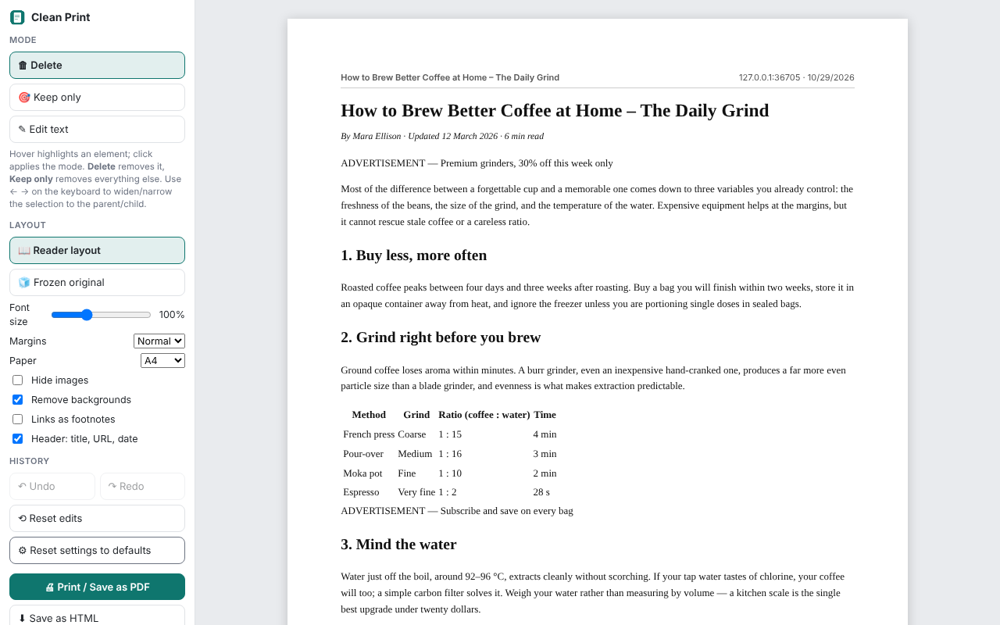

# Clean Print

**Remove ads, menus and clutter before printing. Freeze the page, delete what you don't need, save a clean PDF.**

A Chrome / Edge extension (Manifest V3). No account, no server — everything happens inside your browser.

Website: https://arslanyigitalp.github.io/clean-print/ · Privacy policy: https://arslanyigitalp.github.io/clean-print/privacy.html



## How it works

1. Click the Clean Print icon (or press `Ctrl+Shift+P`) on any web page.
2. The page is **frozen** into an editable copy and opened in a new tab. The original tab is never modified, so your edits can't be lost when the page refreshes.
3. Edit, then **Print / Save as PDF**.

## Features

- **Reader layout** — the article is extracted automatically (Mozilla Readability) and laid out in one readable column.
- **Frozen original** — the full page in a print-friendly flow layout: typography, tables and images are kept; navigation bars, sidebars, cookie banners and fixed overlays are dropped.
- **Delete** — hover over any element and click to remove it. Empty leftovers disappear too, so there are no large blank gaps in the printout.
- **Keep only** — click the part you want and everything else goes away.
- **Edit text** — fix a typo or shorten a paragraph in place.
- Keyboard: `←` / `→` widen or narrow the selection to the parent / child element, `Delete` removes it, `Ctrl+Z` / `Ctrl+Shift+Z` undo / redo.
- Options: font size, margins, A4 / Letter, hide images, remove backgrounds, links as footnotes, header with title / site / date.
- Output: print or save as PDF through the browser's print dialog (tables and images are never split across pages), or save as a standalone HTML file.

## Install

From the Chrome Web Store: *coming soon*.

From source:

1. Download or clone this repository.
2. Open `chrome://extensions` (or `edge://extensions`), enable **Developer mode**.
3. Click **Load unpacked** and choose the `src` folder.

## Permissions

| Permission | Why |
|---|---|
| `activeTab` | Read the page you clicked the icon on, only at that moment. |
| `scripting` | Run the snapshot script in that tab to copy its content and styles into the editor. |
| `storage` | Remember your layout preferences locally. |

No host permissions, no remote code, no data leaves the browser. See the [privacy policy](https://arslanyigitalp.github.io/clean-print/privacy.html).

## Known limitations

- PDF files shown in the browser's built-in viewer can't be edited (they are already print-ready — use `Ctrl+P` there).
- Very large pages are captured partially (first ~6,000 elements).
- Canvas, video and iframe content is not captured; web fonts are replaced by the closest installed font.

## Project layout

```
src/
  manifest.json       Manifest V3
  sw.js               service worker: snapshot → editor tab
  snapshot.js         freezes the page (DOM clone + computed styles, Readability)
  editor/             the editor UI
  vendor/             Mozilla Readability (Apache-2.0)
docs/                 website + privacy policy (GitHub Pages)
store/                store listing assets (screenshots, promo tile)
```

## License

MIT — see [LICENSE](LICENSE). Bundled Readability.js is Apache-2.0 (see `src/vendor/Readability-LICENSE.md`).
